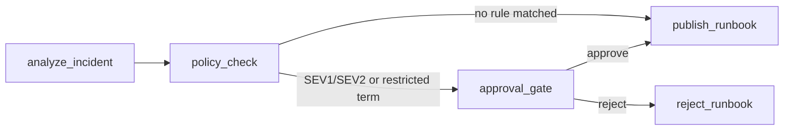

# Build a Resumable LangGraph Workflow

**Project Link:** [View Project](https://nextwork.ai/projects/f94db9b2-1157-404b-a559-83e8752f2f86)

**Author:** Ionut Alexandru

---


## Designing a Safer Automated Publishing Workflow

### Project objective and operator safeguards

In this project, I’m building an incident triage workflow that stops an AI-written runbook from being published until an operator approves it.

## How it works

The workflow is a LangGraph state graph with five nodes.



1. `analyze_incident` sends the incident text to Gemini and gets back structured JSON with a severity, summary, proposed action, risk and rationale.
2. `policy_check` applies fixed rules in code. A human has to review the proposal if the severity is SEV1 or SEV2, or if the incident or the proposed action contains `delete`, `disable`, `drop`, `production`, `restart` or `rotate`. The model's own risk rating plays no part in this decision.
3. `approval_gate` calls LangGraph's `interrupt()`. The run stops and LangGraph saves its state to `incident_checkpoints.db`, so the process can exit and a different process can resume it later.
4. `publish_runbook` writes `runbooks/<incident-id>.md`. `reject_runbook` ends the run as `rejected_without_publish` and writes nothing.

Each node adds a line to `audit_log`, and the published runbook includes the full log.

## Project structure

| File | What it does |
|---|---|
| `naive_app.py` | The unsafe version. Analyses a hardcoded incident and writes `naive_runbook.md` right away with no review. |
| `app.py` | The workflow with the policy check, approval gate and SQLite checkpoints. |
| `inspect_state.py` | Prints a paused workflow's saved state without resuming it. |
| `naive_runbook.md` | Output from `naive_app.py`. |
| `runbooks/incident-001.md` | Output from `app.py` after I approved incident-001. |
| `requirements.txt` | Pinned dependencies. |

## How to run

I built this in Google Cloud Shell with Python 3.12. To run it somewhere else you need a Google Cloud project with billing turned on and the `gcloud` CLI.

### Set up

```bash
git clone https://github.com/ionalexcosa/langgraph-incident-triage.git
cd langgraph-incident-triage
python3 -m venv .venv
source .venv/bin/activate
pip install -r requirements.txt
```

The code calls Gemini through Vertex AI, so point it at your project and turn on the API.

```bash
export GOOGLE_CLOUD_PROJECT=your-project-id
gcloud services enable aiplatform.googleapis.com
gcloud auth application-default login   # skip this in Cloud Shell
```

### Run the unsafe version

```bash
python naive_app.py
```

It writes `naive_runbook.md` straight away. Nobody reviews it first.

### Run the workflow with the approval gate

```bash
python app.py start --thread incident-001 \
  --incident "Production checkout is failing for all users. The proposed emergency action is to restart the production database."
```

The incident text contains `production` and `restart`, so the policy pauses the run whatever severity the model picks. It prints `WORKFLOW PAUSED` and the proposal that's waiting for review.

To look at the saved state without resuming it:

```bash
python inspect_state.py --thread incident-001
```

`next` shows `["approval_gate"]`, and the audit log has no approval or publish entry yet.

### Approve or reject

Run one of these. It works from a new terminal or a later session, because the state lives in `incident_checkpoints.db`.

```bash
python app.py resume --thread incident-001 --decision approve
python app.py resume --thread incident-001 --decision reject
```

Approve writes `runbooks/incident-001.md`. Reject ends the run as `rejected_without_publish` and creates no file. Each thread takes one decision, so to try both, start a second thread such as `incident-002`.

An incident that the model rates SEV3 or SEV4 and that contains none of the restricted words skips the gate and publishes straight away.


## Preparing the Cloud Shell Environment

### Setting up the workflow development environment

In this step, I’m setting up a Google Cloud project with billing, turning on the Agent Platform API and making a project folder with a Python venv. This lets me install LangGraph, the checkpoint library and the Gemini integration.


## Demonstrating the Risks of Unreviewed Publishing

### Building the direct auto-publishing workflow

In this step, I’m building a LangGraph workflow that turns a raw incident report into a runbook.


### Identifying the missing approval control

The direct graph writes the runbook to naive_runbook.md as soon as the model finishes, and no one checks it first. If the model gets the diagnosis wrong or suggests something risky, like restarting the wrong service, it goes straight into the runbook.

## Adding Policy Checks and Human Approval

### Introducing risk policy and approval gates

In this step, I'm adding a human approval boundary so that I can review it before the publishing side effect.


### Deterministic checks that triggered review

Approval was required because the policy found two things. The incident was rated SEV1, and the text included restricted words like “restart” and “production database”. These checks are simple rules in the code, not the model’s opinion, so the same incident triggers approval every time.

## Publishing an Approved Workflow Safely

### Resuming the workflow after approval

In this step, I’m resuming the saved incident from a new Python process. The workflow carries on from its checkpoint instead of starting again.

### Comparing rejection and approval outcomes

When I rejected the proposal, the workflow ended as rejected_without_publish and no runbook file was created. When I approved it, the workflow published runbooks/incident-001.md with the severity, summary and proposed fix. Only the decision changed, so the approval gate is what controls publishing.

## Inspecting Workflow Pause State


### Tracing the values and next fields

The audit_log shows what has happened so far. The model made its analysis and the policy check ran, but there’s no approval or publish entry yet. The policy_reason says why it stopped. The incident was SEV1 and mentioned disabling a production service. The next field shows the graph waiting at approval_gate. I noticed the model rated the risk as low, but the policy still paused it, so the rule doesn’t rely on the model.

## Reflecting on Workflow Safety Skills

### Tools and concepts learned

The key tools I used include Google Cloud Shell, Python venv, LangGraph, Gemini and a SQLite checkpoint database. Key concepts I learnt include human approval steps, interrupts, checkpoints and resuming a saved workflow.

### Project duration and challenges

This project took me about 2 hours. The hardest part was debugging. My billing account was closed, so the Gemini calls failed with a 403 error until I reopened it. Then app.py crashed with a NameError because I’d missed the ANALYSIS_SCHEMA block. Cloud Shell also disconnected me, so I had to go back into the project folder and reactivate the venv.

### Next steps in learning

I did this project to learn how LangGraph works. Next, I want to build a simple agent loop myself without LangGraph, so I understand what it handles for me.

---

*Built with [NextWork](https://nextwork.ai) - [View this project](https://nextwork.ai/projects/f94db9b2-1157-404b-a559-83e8752f2f86)*
